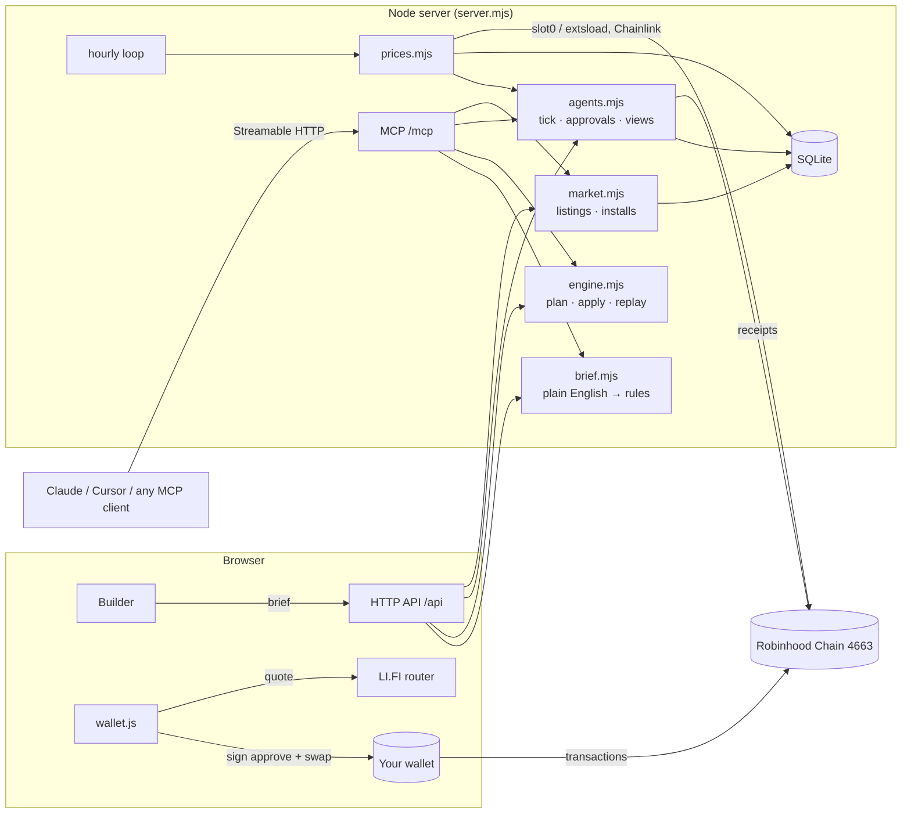

# Architecture

Deskhand is one Node process with one SQLite file. No queue, no external database, no key management: the server never holds a private key, so there is nothing to protect but its own data.

## The hour

Two minutes after every hour, `prices.mjs` reads all 22 pools in one multicall: `slot0()` for Uniswap v3 pools, `extsload()` on the v4 PoolManager for v4 pools. BTC and ETH are compared with their Chainlink feed and the hour is skipped if the pool is more than 2% away. Then `agents.mjs` runs every live agent on the hours it has not decided yet:

1. `plan(config, state, windows, hour)` returns one intent per market: `buy`, `sell` or `hold`, each with the reason in words.
2. A **paper** agent books its intents straight away with `apply()` (0.4% charged per trade).
3. A **wallet** agent books nothing. Each buy or sell becomes an approval request in the owner's desk, valid six hours.
4. Every intent is written to the decision log, and the agent's value is written next to the value of simply holding the same tokens.

## The same engine everywhere

The 30-day simulation in the builder, the replay returned by the MCP tools, paper agents and wallet agents all call the same `plan()`. A replay is therefore not an approximation of what the agent would do: it is what the agent does, on prices that already happened.

## What the server knows about you

Your wallet address (from a signature that costs no gas), your agents, your listings, and the hashes of transactions you chose to report. Sessions are random tokens in an HttpOnly cookie. See [SECURITY.md](../SECURITY.md).

## Files

| File | Lines of responsibility |
|---|---|
| `server.mjs` | Static files, the JSON API, the MCP endpoint, redirects |
| `lib/db.mjs` | Schema: users, sessions, closes, agents, decisions, equity, approvals, listings, versions, installs |
| `lib/prices.mjs` | Backfill (hourly candles), on-chain hourly reads, bad-print scrub, `series()` |
| `lib/brief.mjs` | The plain-English reader ([language reference](brief-language.md)) |
| `lib/engine.mjs` | Indicators, rules, `plan`, `apply`, `replay`, `readable`, `permissions`, config validation ([engine](engine.md)) |
| `lib/agents.mjs` | Agent lifecycle, the tick, approvals and settlement, leaderboard, markets view |
| `lib/chain.mjs` | Receipt reading (fills and payments) and live routes |
| `lib/market.mjs` | Listings, versions, installs, paid listings |
| `lib/mcp.mjs` | MCP server ([reference](mcp.md)) |
| `lib/house.mjs` | The six agents Deskhand runs and lists itself |
| `public/js/wallet.js` | Everything the browser signs ([wallet mode](wallet-mode.md)) |
